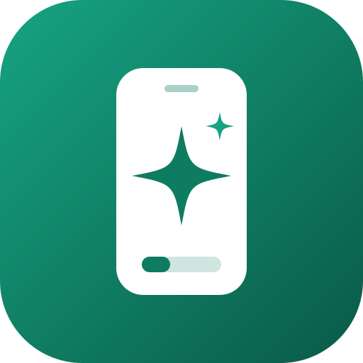
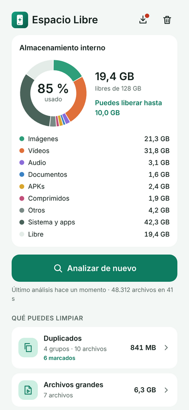
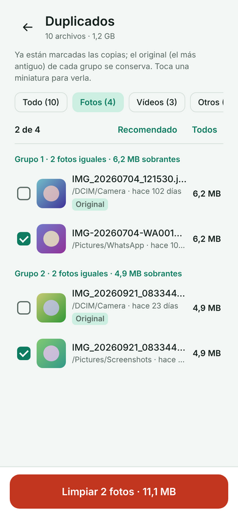
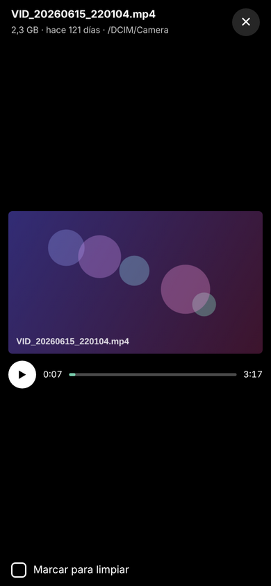

<div align="center">



# Espacio Libre

**Encuentra lo que llena tu Android y libéralo con seguridad.**
Copias, vídeos pesados, restos de apps y fotos repetidas, en un solo análisis y sin que nada salga de tu móvil.

[](https://github.com/N23GR045/Limpiador-de-archivos-moviles/releases/latest)
[](https://github.com/N23GR045/Limpiador-de-archivos-moviles/actions/workflows/build-apk.yml)


[](LICENSE)

[**⬇ Descargar la última versión**](https://github.com/N23GR045/Limpiador-de-archivos-moviles/releases/latest/download/EspacioLibre.apk)

<!-- VÍDEO DE PRESENTACIÓN: edita este archivo en github.com, arrastra aquí el .mp4 y GitHub lo incrusta. -->

&nbsp;
&nbsp;


</div>

---

## ✨ Qué hace

Un análisis recorre el almacenamiento interno y ordena lo que sobra en seis grupos. Cada uno dice cuánto espacio puedes recuperar y, cuando es seguro, deja marcada una selección recomendada.

| Grupo | Qué encuentra | Viene marcado |
| --- | --- | --- |
| **Duplicados** | Copias exactas del mismo archivo, separables en fotos, vídeos y otros | Todas las copias menos el original |
| **Archivos grandes** | Vídeos de más de 100 MB e instaladores de apps (APK) | Nada: eliges tú |
| **Temporales y caché** | Restos que las apps vuelven a crear solas | Todo |
| **Descargas antiguas** | Lo que está en Descargas desde hace más de 3 meses | Nada: eliges tú |
| **Fotos borrosas** | Fotos movidas o desenfocadas | Nada: eliges tú |
| **Fotos similares** | Ráfagas y fotos casi iguales | Todas menos la más nítida |

Además puede vaciar **la caché de todas tus apps** de una vez, con la confirmación de Android.

### Pensada para que no te arrepientas

- 🗑️ **Papelera de 30 días.** Por defecto nada se borra para siempre: puedes restaurarlo a su carpeta.
- 🛡️ **El original nunca se marca.** En cada grupo de copias se conserva la más antigua, y la app avisa si intentas borrarlas todas.
- 👁️ **Mira antes de borrar.** Toca cualquier foto o vídeo para verlo a pantalla completa.
- 🔒 **Privada.** Todo se analiza en el móvil. La única conexión que hace es para buscar actualizaciones.
- 🔄 **Se actualiza sola.** Avisa cuando hay versión nueva, la descarga y la instala encima sin perder nada.

---

## 📲 Instalación rápida

1. Descarga [**EspacioLibre.apk**](https://github.com/N23GR045/Limpiador-de-archivos-moviles/releases/latest/download/EspacioLibre.apk) desde tu Android.
2. Ábrelo. Si Android avisa de que viene de una fuente desconocida, toca **Ajustes → Permitir de esta fuente** y vuelve.
3. Toca **Instalar**.

> **¿Ya la tenías?** No hace falta repetir esto: la app te avisará de cada versión nueva y se actualizará desde dentro.
> Si tu versión es anterior a la 1.0.5, desinstálala una vez antes de instalar la nueva.

Requisitos: Android 8.0 o superior. No funciona en iPhone: iOS no deja que una app revise los archivos de las demás.

---

## 🧭 Cómo se usa

1. **Permite el acceso a tus archivos.** Android abre sus Ajustes: activa *Permitir acceso para gestionar todos los archivos* y vuelve atrás.
2. **Toca «Analizar ahora».** El primer análisis es el más largo; los siguientes van más rápido porque la app recuerda lo que ya calculó.
3. **Revisa un grupo.** Empieza por *Temporales y caché* y *Duplicados*, que ya vienen con la selección recomendada.
4. **Toca «Limpiar».** Elige entre mover a la papelera (recuperable 30 días) o borrar para siempre.
5. **Vacía la papelera** cuando estés seguro, para que el espacio quede libre.

<details>
<summary><b>¿Qué permisos pide y por qué?</b></summary>

| Permiso | Para qué | ¿Obligatorio? |
| --- | --- | --- |
| Acceso a todos los archivos | Recorrer el almacenamiento y mover o borrar lo que elijas | Sí |
| Acceso a datos de uso | Ver cuánto ocupa la caché de cada app | No |
| Instalar apps desconocidas | Instalar las actualizaciones que descarga la propia app | Solo para actualizar |
| Internet | Comprobar si hay versión nueva en GitHub | Solo para actualizar |

</details>

<details>
<summary><b>Límites de Android que conviene saber</b></summary>

- Desde Android 11, las carpetas `Android/data` y `Android/obb` están cerradas a otras apps. Por eso la caché interna de cada app se vacía con el diálogo del sistema y no archivo por archivo.
- Android no guarda bien cuándo abriste un archivo por última vez, así que «descarga antigua» se basa en la fecha de modificación.
- Para que el análisis no se alargue, se revisan como máximo las 4.000 fotos más recientes.
- Google Play revisa a mano las apps que piden acceso a todos los archivos; por eso, de momento, se instala desde aquí.

</details>

---

## 🛠️ Para desarrolladores

**Stack:** Kotlin · Jetpack Compose (Material 3) · Coroutines y Flow · Coil para miniaturas de fotos y vídeos. Sin dependencias de red salvo la API pública de GitHub Releases.

```bash
git clone https://github.com/N23GR045/Limpiador-de-archivos-moviles.git
cd Limpiador-de-archivos-moviles
./gradlew assembleDebug        # APK en app/build/outputs/apk/debug/
```

También puedes abrir la carpeta en Android Studio y pulsar ▶ con un móvil conectado.

<details>
<summary><b>Cómo detecta cada cosa</b></summary>

| Grupo | Método |
| --- | --- |
| Duplicados | Mismo tamaño → hash de los primeros 64 KB → MD5 completo. Casi nunca hace falta leer un archivo entero |
| Fotos borrosas | Varianza del Laplaciano sobre la foto reducida; por debajo de 80, borrosa |
| Fotos similares | dHash de 64 bits; distancia de Hamming de 8 o menos |
| Caché de apps | `StorageStatsManager` y el intent `ACTION_CLEAR_APP_CACHE` (Android 11+) |

Todos los umbrales están en [`scanner/ScanConfig.kt`](app/src/main/java/com/despeja/app/scanner/ScanConfig.kt). Los hashes se guardan entre análisis.

</details>

<details>
<summary><b>Estructura del código</b></summary>

```
app/src/main/java/com/despeja/app/
├── MainActivity.kt / MainViewModel.kt   Entrada, estado y navegación
├── model/          Archivos, categorías y resultados
├── scanner/        Recorrido, duplicados, análisis de fotos y caché de hashes
├── system/         Permisos, papelera, caché de apps y actualizaciones
└── ui/             Pantallas y componentes en Compose
```

</details>

**Versiones:** cada cambio en `main` compila el APK con GitHub Actions y publica una versión nueva en [Releases](https://github.com/N23GR045/Limpiador-de-archivos-moviles/releases). El mensaje del commit aparece como «Novedades» dentro de la app, así que conviene escribirlo pensando en quien la usa.

---

## 🤝 Contribuir

Las ideas, los avisos de fallos y las mejoras son bienvenidos.

1. **¿Has encontrado un fallo?** Abre un [issue](https://github.com/N23GR045/Limpiador-de-archivos-moviles/issues) con el modelo de móvil, la versión de Android y los pasos para repetirlo.
2. **¿Quieres cambiar algo?** Haz un fork, crea una rama (`git checkout -b mejora-descripcion`) y abre un pull request explicando qué cambia para quien usa la app.
3. **Textos:** se escriben de tú, con un verbo por acción (*Analizar*, *Limpiar*, *Mover a la papelera*, *Borrar para siempre*) y sin jerga técnica.
4. **Seguridad ante todo:** ningún cambio debe borrar archivos sin confirmación ni saltarse la papelera por defecto.

---

## 📄 Licencia

Publicado bajo la [licencia MIT](LICENSE): puedes usarlo, modificarlo y compartirlo, manteniendo el aviso de copyright.
